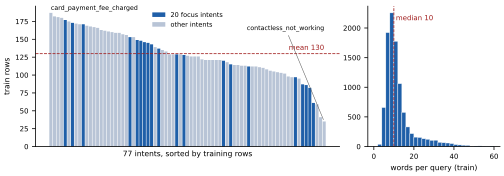

# 3. Dataset description and preparation

BANKING77 [1] contains English customer-service queries from the online-banking domain, each labelled with one of 77 fine-grained intents. Each row has two fields: `text`, the customer's message, and `label`, the intent. We read the official train and test files published by the dataset's authors, with the label order from the dataset's Hugging Face card.

<!-- include: generated/dataset_facts.md -->

Figure 1. Left: training rows per intent, sorted, with the 20 focus intents highlighted. Right: query length in words (training split).

**What the data says about the task.** Queries are short, with a median of 10 words, and informal, so the model has to infer intent from very little text. The training split is moderately imbalanced, from 35 rows for `contactless_not_working` to 187 for `card_payment_fee_charged`, while the test split is exactly balanced at 40 rows per intent, which makes macro-averaged metrics on test data meaningful. Many intents differ by a single detail of the customer's situation: whether a card has *not arrived* or *when it will arrive*, whether a top-up *failed* or is *pending*. These near-duplicates are where we expect errors (Appendix H). Six texts appear in both splits and four occur more than once within the training split. Few-shot candidates exclude every evaluation query, so no evaluation query can appear as a worked example.

**Representative examples.** Two intents from each of the five service themes used in the failure analysis:

<!-- include: generated/dataset_examples.md -->

**Preparation.** The steps below are stored as data in `data_prep.PREPROCESSING_STEPS`, so this list quotes the code rather than paraphrasing it. The full preprocessing record is in Appendix G.

<!-- include: generated/preprocessing_steps.md -->

**Subsets used for experiments.**

- **Evaluation sample:** 385 rows from the test split, five per intent, seed 42. Every reported number uses it.
- **Few-shot bank:** four training-split examples, one per routing outcome, excluding every evaluation query:

<!-- include: generated/fewshot_bank.md -->

- **Decoding study (E3):** [[CONFIRM §3 — a stratified 77-row subset, one query per intent; update once the E3 run confirms the subset used.]]
- **Failure-analysis focus set:** 20 intents in five service themes, with six confusable pairs predicted before any results existed (Appendix H).
