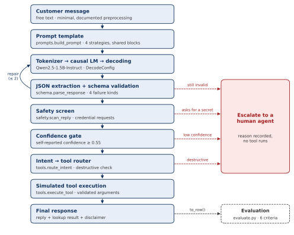

# 5. Proposed application architecture

Figure 2 shows the workflow. It implements the brief's minimum technical workflow end to end: sample selection and prompt construction, tokenizer and pretrained LM, decoding control, structured-output validation, tool decision and tool result, final response, and an evaluation harness reading every run.

Figure 2. SafeBank Assist pipeline. Solid arrows: normal flow. Dashed red arrows: conditions that hand the case to a person with a recorded reason. Names refer to modules of the <code>safebank</code> package.

Four design decisions shape it:

- **The model sits behind a one-method interface.** The pipeline depends on a `TextGenerator` protocol, `generate(prompt, decode) -> str`, never on a model runtime. The same code runs with a scripted generator in tests and with the real Hugging Face model [17] in the notebook, and the decoding study changes only a `DecodeConfig` value. This is why the whole control flow is covered by 353 automated tests that need no GPU.
- **Code, not the model, decides what happens.** The tool to run is looked up from the *validated* intent, never taken from the model's own `tool_call` field, so a hallucinated tool request cannot reach an executor.
- **Irreversible actions need a person.** `block_card` is marked destructive and is never executed automatically, even at confidence 1.0; the case is escalated for the customer's explicit confirmation.
- **Every outcome is recorded.** Each run produces one flat record (`PipelineResult.to_row()`) holding the intent, confidence, attempts, first failure kind, tool, safety findings, escalation and latency, which the evaluation code reads directly. When several checks fire, the most serious escalation reason is kept.

| Module | Responsibility | Experiments |
|---|---|---|
| `data_prep` | load BANKING77, evaluation sample, few-shot bank, preprocessing record | input to all |
| `prompts` | four prompt strategies built from shared blocks | E2 |
| `model_loader`, `generator` | model loading, the `TextGenerator` interface, `DecodeConfig` | E1, E3 |
| `schema` | output contract, JSON extraction, validation, repair prompt | E4 |
| `tools` | three simulated tools, their I/O schemas, intent → tool router | E5 |
| `safety` | screen replies for credential requests and invented account facts | R13 |
| `pipeline` | end-to-end orchestration | E7 |
| `decoding`, `evaluate` | decoding grid; six evaluation criteria and failure analysis | E3, E6 |
